# Twelve wishes of the Mandelbulb Maniacs group

The Facebook group *Mandelbulb Maniacs* (about 20 000 members) has used MB3D since 2013. Its posts were read for what people ask for, what trips them up and what they do by hand. These twelve changes answer the most common wishes:

1. [360 photos that Facebook recognises](#1-360-photos-that-facebook-recognises)
2. [Maps of any name](#2-maps-of-any-name)
3. [A better colour picker](#3-a-better-colour-picker)
4. [Errors in plain words](#4-errors-in-plain-words)
5. [The Share window](#5-the-share-window)
6. [Mandelbulber settings files open](#6-mandelbulber-settings-files-open)
7. [The Formula book](#7-the-formula-book)
8. [Step settings for the post passes, and the noise doctor](#8-step-settings-for-the-post-passes-and-the-noise-doctor)
9. [Background pictures 1:1](#9-background-pictures-11)
10. [Texture export](#10-texture-export)
11. [Mesh export without flying parts, smaller](#11-mesh-export-without-flying-parts-smaller)
12. [The benchmark](#12-the-benchmark)

The pictures on this page come from the program itself (`cargo run --example communityshots`).

## 1. 360 photos that Facebook recognises

**What people did by hand.** A spherical panorama only shows as an interactive 360 photo on Facebook when the file says it comes from a 360 camera. Members open each picture's file properties in Windows Explorer and type *RICOH* as the camera maker and *RICOH THETA S* as the model.

**What the program does now.** Every 2:1 picture rendered with the camera optic *spherical panorama* gets two sets of tags:

* the Photo Sphere tags (`GPano`, read by Facebook, Google Photos and most 360 viewers), which JPEG files already had;
* the camera of a 360 camera: Make `RICOH`, Model `RICOH THETA S`, Software `mb3d-rs`.

Both go into JPEG and PNG files, however they are saved:

* the main window's PNG, JPEG and 16 bit PNG buttons;
* the Monte Carlo window;
* the batch;
* the command line, including `mb3d vr360` on an existing JPEG;
* the Share window (below).

A panorama saved as JPEG, read back with `exiv2`:

```text
Exif.Image.Make            Ascii   6  RICOH
Exif.Image.Model           Ascii  14  RICOH THETA S
Exif.Image.Software        Ascii  14  mb3d-rs 0.3.4
Xmp.GPano.ProjectionType   XmpText 15 equirectangular
Xmp.GPano.UsePanoramaViewer XmpText 4 True
```

**Switching it off.** Untick *360 photos: the camera tag Facebook looks for* in the Share window. The program remembers the choice as `Pano360CameraTag` in its ini file. On the command line, set `MB3D_360_CAMERA_TAG=0`. The Photo Sphere tags stay either way.

## 2. Maps of any name

**What tripped people up.** Parameters refer to maps by number, so a picture had to be renamed to a number (`57.png`) before it could be a map. Beginners also found that a picture from another folder only worked until the program was closed.

**What the program does now.** Right-click a map number and choose any picture from any folder. These places have the map chooser:

* the Lighting window's light map number;
* the Lighting window's colour map number (*Object* tab, *Use a map for the diffuse color*);
* the *Map nr* of a height map formula in the Formula window. Its right-click chooser is new.

The picture becomes a map like this:

* A picture that already has a free number at the start of its name keeps it.
* Any other picture is copied into the maps folder as `<number> <its name>`, with the next free number. `Brick wall (rough).png` becomes `3052 Brick wall (rough).png`.
* A picture that is already in the map folders under a number keeps that number, and nothing is copied twice.
* The copy never replaces a file.

The main window's messages say where the copy went:

```text
Brick wall (rough).png was copied into the maps folder as map 3052: …/M3Maps/3052 Brick wall (rough).png
```

Because the copy has a number at the start of its name, MB3D finds it too.

A background picture from another folder is copied into the maps folder under its own name, so the scene finds it the next time it is opened.

<a href="img/community/maps_light_window.png">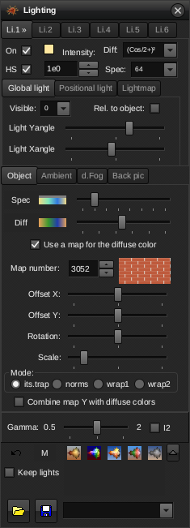</a>
<a href="img/community/maps_main.png">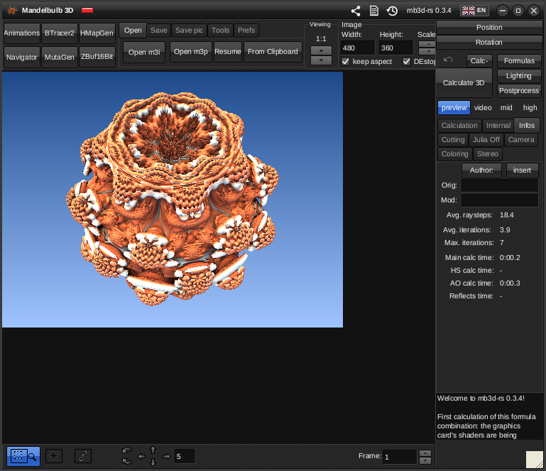</a>

The hint of the map number says how it works. In the Formula window it shows on the map number of a height map formula:

<a href="img/community/maps_formula_window.png">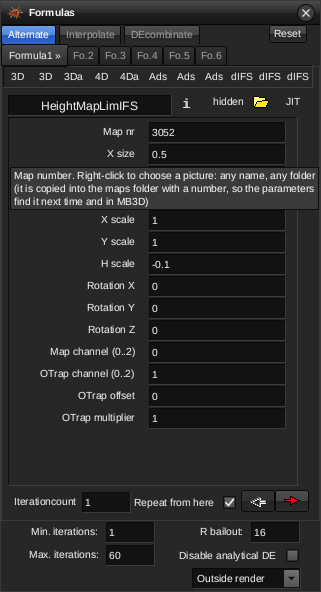</a>

**A bug that went away.** The old chooser silently did nothing for a picture without a number. It also took the first digits anywhere in the name, so `brick2.png` loaded map 2, a different picture.

## 3. A better colour picker

The colour dialog opens from every colour button: lights, the palette, ground, clouds and others. It has three additions.

**Hex.** The colour is shown as `#RRGGBB`, ready to copy. You can also type one: `#4080C0`, `4080C0`, `0x4080C0` and the short `#48C` all work. A moderator of the group asked for this.

**Recent colours.** The eight colours chosen last sit under the basic colours, newest first. The program keeps them between sessions.

**Eyedropper.** Press *Eyedropper*, then click any pixel in any of the program's windows: the picture, a map preview, the palette or another window. That pixel's colour becomes the dialog's colour. The cursor is a cross while it waits, and Esc stops it.

The eyedropper reads the window as the program paints it, so it works at any interface size. It cannot read the windows of other programs, because Wayland, the Linux desktop protocol, does not allow that.

<a href="img/community/eyedropper_on.png">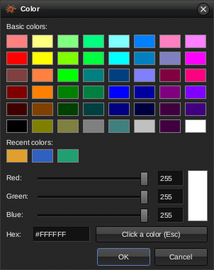</a>
<a href="img/community/eyedropper_picked.png">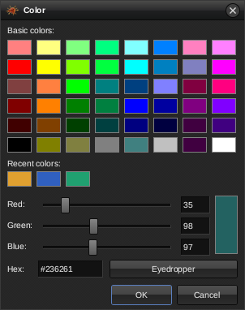</a>

Left: waiting for the click. Right: a colour taken from the fractal in the main window.

**Borrowing a palette.** Members often keep another artist's colours and change everything else. The *Color adjustment* window has three new buttons for this:

* **Colors from file...** takes only the colours from a parameter file (`.m3p`, `.m3i`, text) or a light file (`.m3l`). It copies the surface palette with its transparency and the inside colours. The lights, fog, maps, fractal and view stay as they are.
* **From Clipboard** does the same with parameters copied from a post.
* **Save colors...** writes the lighting with these colours as a light file, which MB3D can open too.

<a href="img/community/color_form_buttons.png">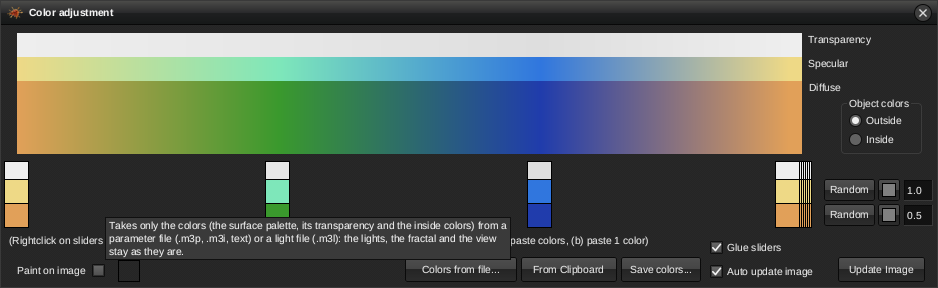</a>

## 4. Errors in plain words

The group's beginners keep asking what two messages mean: "formula option is not valid" and "mixing of dIFS will not work". These errors now open a window that explains them and says what to do.

**A formula that is not installed.** Parameters can name a formula this computer does not have. That often happens with parameters from a tutorial, because each installation has different formula packs. Opening such parameters used to end with a terse line. Pasting them said "No text parameters found", which was wrong.

The window now says:

* which formula is missing;
* that formulas are `.m3f` files, often shared with the parameters or in a formula pack;
* which folders formulas go into;
* which installed formulas have a similar name.

<a href="img/community/explain_missing_formula.png">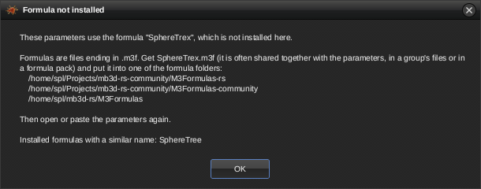</a>

**dIFS formulas mixed with others.** A dIFS formula builds a shape straight from distances. Bulbs and boxes are fractals iterated step by step. One formula chain cannot calculate both, so the calculation stops with "mixing of dIFS with other formulas will not work".

The window explains the two kinds and the DE combination that shows both. When the slots hold one kind first and the other after it, the window offers **Set up DE combination**. That button joins the two parts with *min*, which keeps both objects, and calculates again.

<a href="img/community/explain_difs.png">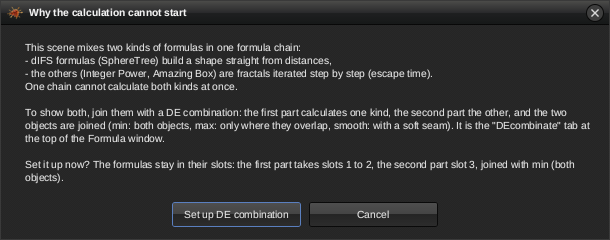</a>

After the button, the Formula window is on its *DEcombinate* tab with part 2 starting at slot 3, and the picture is calculated:

<a href="img/community/explain_difs_fixed_formulas.png">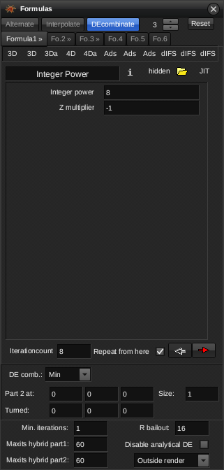</a>
<a href="img/community/explain_difs_fixed_main.png">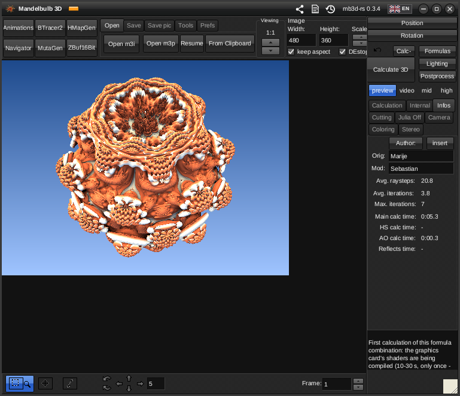</a>

When the two kinds take turns in the slots, the window says how to reorder them first. It does not offer the button then.

**The other cases** get a short explanation too:

* one part of a DE combination mixes dIFS and other formulas;
* dIFS transforms have no dIFS shape after them;
* dIFS formulas are in an interpolation hybrid;
* no slot holds a fractal formula with iterations, which is the "formula option is not valid" case.

## 5. The Share window

**What the group asks of a post.**

* The parameters come as a `.txt` file. Facebook turns pasted parameters into links, and it has banned members for "spam" because of them.
* A tweak credits the artist whose parameters it started from.

**What the window does.** The share icon in the main window's title bar, left of the log icon, opens it:

<a href="img/community/titlebar_share_hint.png">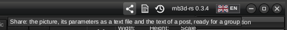</a>

<a href="img/community/share_window_made.png">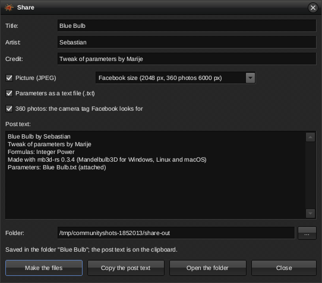</a>

The window starts filled in from the scene:

* **Title** is the parameters' name.
* **Artist** and **Credit** come from MB3D's *Orig* and *Mod* authors on the main window's *Infos* page. When the parameters were changed by someone else, the credit reads "Tweak of parameters by …" with the original artist.
* **Picture (JPEG)** comes in two sizes. *Facebook size* has a long side of 2048 pixels, which Facebook keeps sharp; a 360 photo stays up to 6000 pixels wide. *Full size* keeps the picture as it is.
* **Parameters as a text file** writes the parameters with the title, artist, credit, formulas and program version above them. The file opens again in mb3d-rs and in MB3D, because both look for the `Mandelbulb3Dv18{` block.
* **Post text** is written from the fields and can be edited before it is used. It names the formulas; a DE combination is shown as both parts and its kind.

**Make the files** writes a folder of its own, `Pictures/Share/<title>` by default:

```text
Blue Bulb/
  Blue Bulb.jpg    the picture, with the 360 tags for a panorama
  Blue Bulb.txt    the parameters with the lines about them
  post.txt         the post text
```

It also puts the post text on the clipboard. **Open the folder** shows the folder in the file manager. A second share with the same title gets its own folder, `Blue Bulb 2`.

The post text of the example:

```text
Blue Bulb by Sebastian
Tweak of parameters by Marije
Formulas: Integer Power
Made with mb3d-rs 0.3.4 (Mandelbulb3D for Windows, Linux and macOS)
Parameters: Blue Bulb.txt (attached)
```

## 6. Mandelbulber settings files open

**What the group asks.** "How do I input this Mandelbulber settings file?" Parameters traded in the group come from both programs, and nobody wants to type a camera and a formula over by hand.

**What the program does.** A Mandelbulber settings file (`.fract`) opens like any parameter file: through *Open* (the file type "Mandelbulber settings"), by dropping it on the main window, on the command line (`mb3d file.fract -o out.png`) and in the MCP tools. Pasted text that starts with `# Mandelbulber settings file` is recognised by that line, whatever the file is called.

<a href="img/community/import_main.png">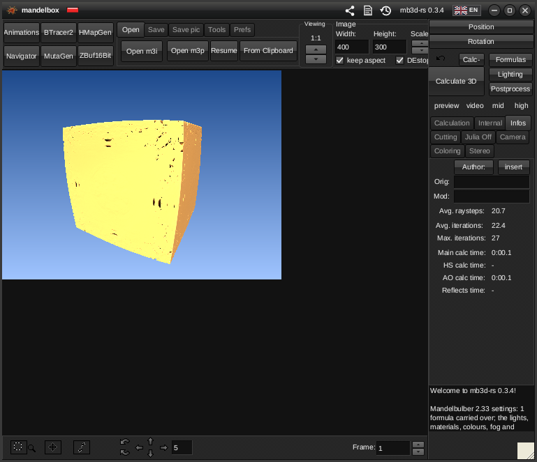</a>

What is carried over:

* **The camera.** Mandelbulber keeps an eye, a target and a top vector; MB3D keeps a pivot, a start plane, a rotation matrix and a zoom. The eye, the view direction, the up vector and the field of view come out the same (Mandelbulber's angle is the horizontal one, MB3D's the vertical, the file's aspect ratio converts between them). Equirectangular cameras become a spherical panorama, fish eyes MB3D's fish eye.
* **Picture size, iteration count, Julia mode and constant, detail level** (the inverse of MB3D's DE stop), **DE factor** (the ray step), and the two **background colours** (MB3D's ambient top and bottom, which it shows as the background).
* **The formulas both programs have.** A good part of Mandelbulber's list was ported from MB3D, so those map one to one with their values: Mandelbox and Mandelbox fast (Amazing Box with scale, fold and min radius), the Mandelbulbs (Integer or Real Power by the power), Mandelbulb power 2, Quaternion, Menger sponge (Menger3), Menger smooth, Amazing Surf and ASurfMod1, ABoxMod1, ABoxMod2, ABoxModKali, ABoxVS_icen1, Aexion, BristorBrot, the MsltoeSym2/3/4 mods, Kalisets1, IQ-bulb, Sierpinski 3D, box fold bulb pow2 (Folding Int Pow). A formula that only resembles one here (Benesi, the Riemann spheres, kaleidoscopic IFS, pseudo Kleinian, the Mandelbulb variants ...) becomes that similar formula at its default values, and the notes say so.
* **Hybrids** become MB3D's slots with their iteration counts. Mandelbulber's boolean objects become a DE combination of the first two.

What is not: lights, materials, colours, fog, effects, Mandelbulber-only formulas (hypercomplex, the transforms of the 1000 series, its newer variants) and the fractal rotation and constant factor. Every one of these is named in the notes, which go to the main window's message area and the log, so the user knows what to set by hand. A file whose formulas all lack a counterpart is refused with that reason rather than opened empty.

<a href="img/community/import_formulas.png">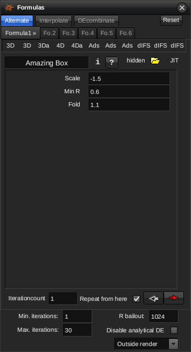</a>

The import is in `src/mandelbulber.rs`; its tests (`tests/mandelbulber.rs`) check the camera against the file's eye, direction and top vector, the formulas and values, the hybrid slots, the Julia constant and the notes.

## 7. The Formula book

**What the group asks.** "Plain-language documentation of each formula and parameter"; what dIFS means; why Amazing Surf did nothing for two years; what the error "formula option is not valid, mixing of dIFS will not work" is about. MB3D's formula window shows a description only when the formula's author wrote one, and never says what *Scale* or *Min R* do.

**What the window does.** The `?` button of the Formulas window (right of *Hidden*) opens the Formula book; *About this formula...* in the right-click menu of a formula name opens it at that formula.

<a href="img/community/book_button.png">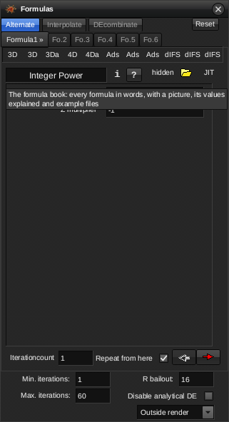</a>

<a href="img/community/book_window.png">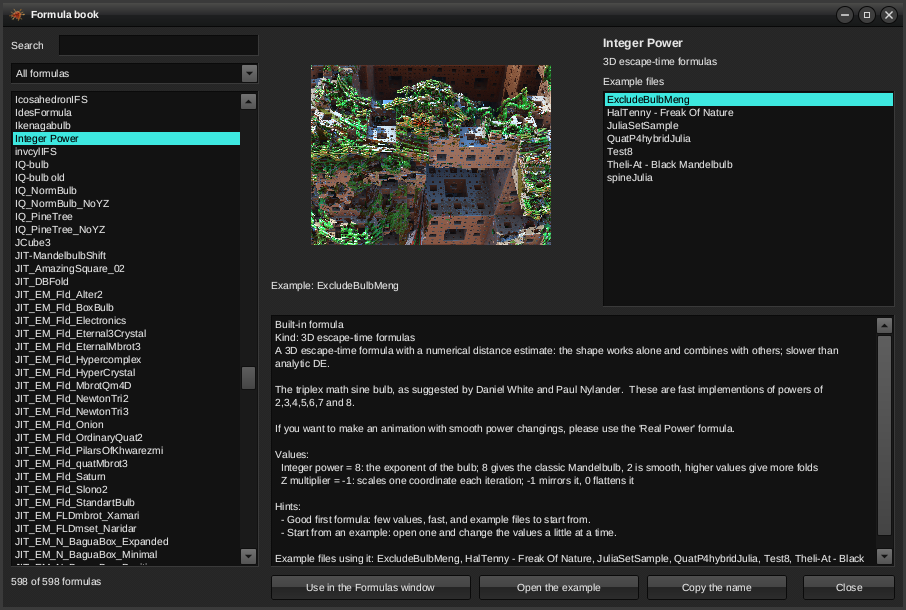</a>

The left side lists every formula the Formulas window lists (the built-in ones and the formula files), filtered by a search box and by kind: 3D escape-time formulas, 3D formulas with analytic DE, 4D, 4D analytic, transformations, dIFS shapes, dIFS transformations. The page of the chosen formula has:

* **A picture.** The first example file that uses the formula, rendered by the same preview queue as the History window; a formula no example uses is shown alone at its default values (a transformation with a bulb or a dIFS box behind it, since it shows nothing alone).
* **Its kind in words.** What the DE option means for the user: a 3D formula with analytic DE "is fast and robust; a good first formula"; a transformation "changes the point only and has no shape of its own, use it before or between shaping formulas, never alone"; a dIFS shape "combine it only with other dIFS formulas; mixing it with escape-time formulas gives the error 'formula option is not valid'".
* **The author's description** from the `.m3f` file (563 of the 593 shipped formula files have one).
* **The values explained.** Each value with its default and, for the names that follow the conventions (Scale, Fold, Min R, CScale, Power, Julia, angles, offsets, multipliers, vary, DE, thickness, levels, size, inversion, mode, smoothing, colour, W), a sentence on what it does and which values are the classic ones.
* **Hints.** "Good first formula" for a fast formula with few values and examples; "patience" for 4D formulas with numerical DE; "watch the 4D rotation"; "start from an example"; "a transformation shows nothing alone"; "many values: change one at a time and keep what you like with the History window".
* **Example files** from the parameter folder and the folder of the parameters opened last, by the formulas they use; *Open the example* loads one. *Use in the Formulas window* puts the formula into the chosen slot; a double click on a name does the same.

<a href="img/community/book_search.png">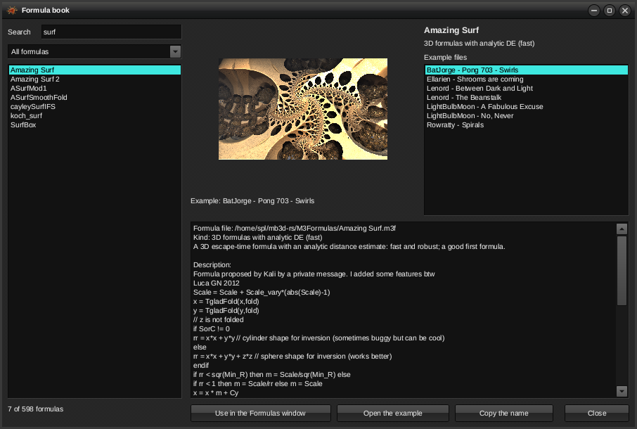</a>

<a href="img/community/book_difs.png">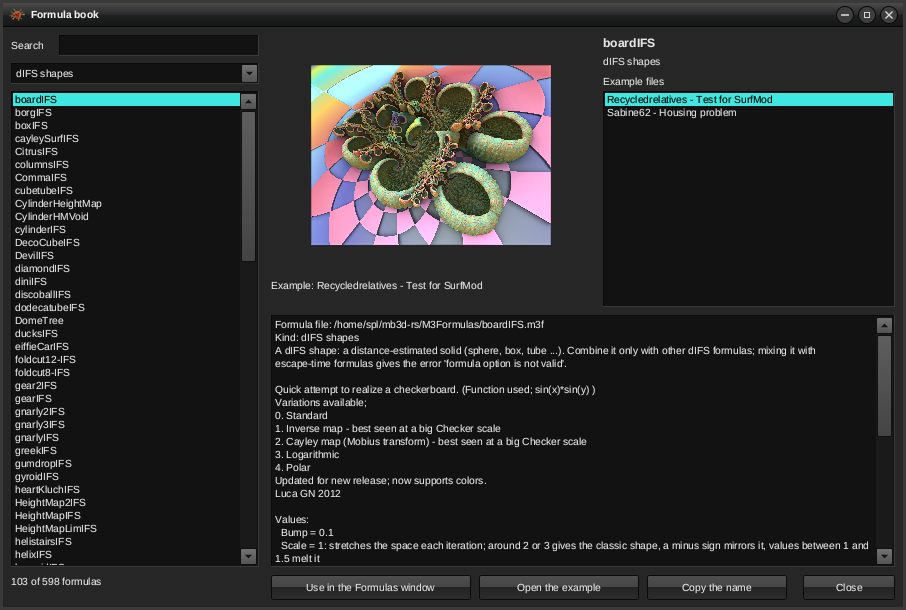</a>

The texts are labels, so the book comes in all 17 languages. What the book says comes from what the program has (the DE option, the formula file, the value names, the example files): it is not a hand-written encyclopedia, and a formula whose values have unusual names shows them with their defaults alone. The logic is in `src/formula_book.rs` (tested), the window in `src/app/formula_book_form.rs`.

## 8. Step settings for the post passes, and the noise doctor

**What the group asks.** Two things about noise. The trick of the experienced: render the main pass with a tiny ray step (0.01), then put the step back to normal before the shadows, the occlusion, the reflections and the depth of field, so the expensive setting is paid only where it shows. And the folk wisdom about black specks ("the step width limiter should be 1, not 0.1", "a higher ray step sometimes gives less noise on dIFS") that contradicts itself from post to post.

**What the program does.** The Internal tab has a new button, *Steps and noise...*:

<a href="img/community/internal_tab.png">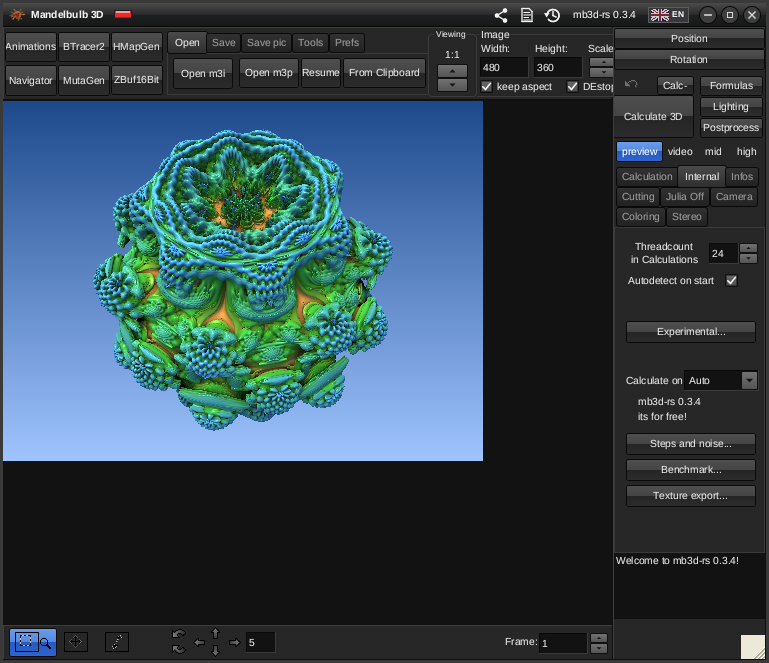</a>

<a href="img/community/steps_window.png">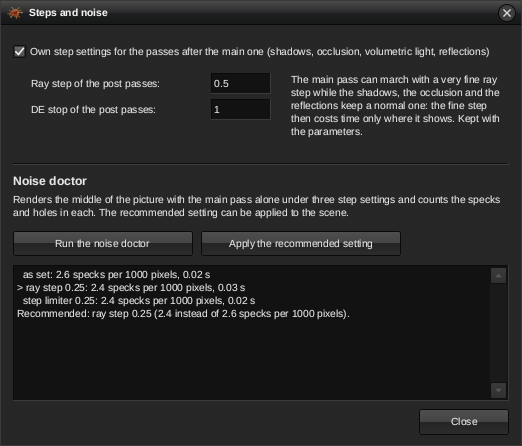</a>

* **Own step settings for the post passes.** With the check box on, the shadows, the DE ambient occlusion, the volumetric light and the reflections march with the ray step and DE stop given here, while the main pass keeps the main window's. The settings are kept with the parameters (`post_raystep`, `post_de_stop` in the mb3d-rs block; MB3D ignores them). The card's own shadow and occlusion passes keep the main pass's settings.
* **The noise doctor** renders the middle of the picture (up to 256 x 192 pixels) with the main pass alone under three settings: as set, half the ray step, and a quarter of the step limiter (or a quarter of the ray step when the limiter is tight already). It counts the specks (a pixel far brighter or darker than its neighbours) and the holes (a background pixel among surface pixels, or the reverse) in each and reports them per thousand pixels with the time each took. *Apply the recommended setting* puts the winner into the scene: the fewest specks, among equals the fastest, and never a change for a twentieth of a speck.

## 9. Background pictures 1:1

**What the group asks.** A background picture of the render's own size came out blurred, so people sharpened it beforehand.

**What the program does.** When the background picture is shown directly (not as a sphere map) and has exactly the picture's size, every pixel of it is taken as it is. MB3D sampled it half a pixel off through its spline, which blurred it; a background of another size is still interpolated as before. True supersampling is in the command line (`--aa 2`) and in the Big renders window (the downscale factor); the main window's picture is still calculated at its set size.

## 10. Texture export

**What the group asks.** Textures from fractals: a field of view of 1, depth fog only, lights off, the picture inverted and fed to Substance Designer for a PBR set.

**What the program does.** *Texture export...* on the Internal tab writes the maps of the calculated picture as PNG files side by side:

<a href="img/community/texture_window.png">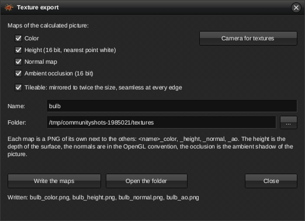</a>

* **Colour** as rendered; **height** (16 bit, the depth of the surface, the nearest point white, the background black); **normal map** (the surface normals in the OpenGL convention, red right, green up, blue towards the viewer); **ambient occlusion** (16 bit, the picture's ambient shadow, open surface white).
* **Tileable** mirrors the set to twice the size, which joins seamlessly at every edge.
* **Camera for textures** sets the group's recipe: a planar optic with a field of view of one degree, nearly orthographic, so the height map has no perspective. Calculate again afterwards, then write.

<a href="img/community/texture_bulb_height.png">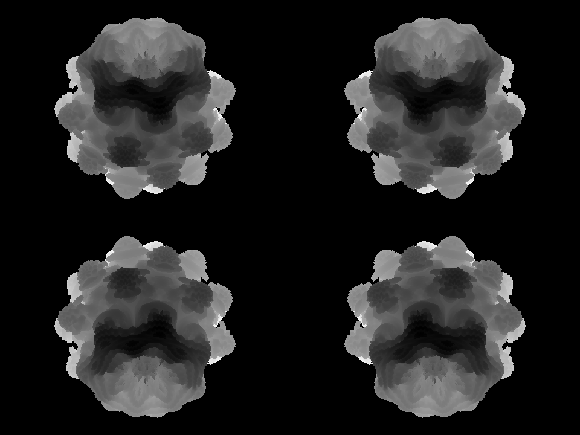</a> <a href="img/community/texture_bulb_normal.png">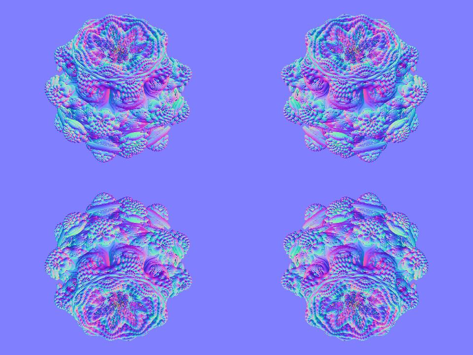</a> <a href="img/community/texture_bulb_ao.png"></a>

Roughness and metallic maps are material values, not something a render can measure; a material editor derives them from the height and occlusion maps.

## 11. Mesh export without flying parts, smaller

**What the group asks.** The mesh workflow was voxels to Fiji to a 1.2 GB OBJ to MeshLab to remove the flying parts and decimate, and a plugin for Blender.

**What the program does.** The Bulb Tracer window's *Mesh properties* have two new fields, and `mb3d mesh` the options `--islands` and `--decimate`:

<a href="img/community/mesh_fields.png">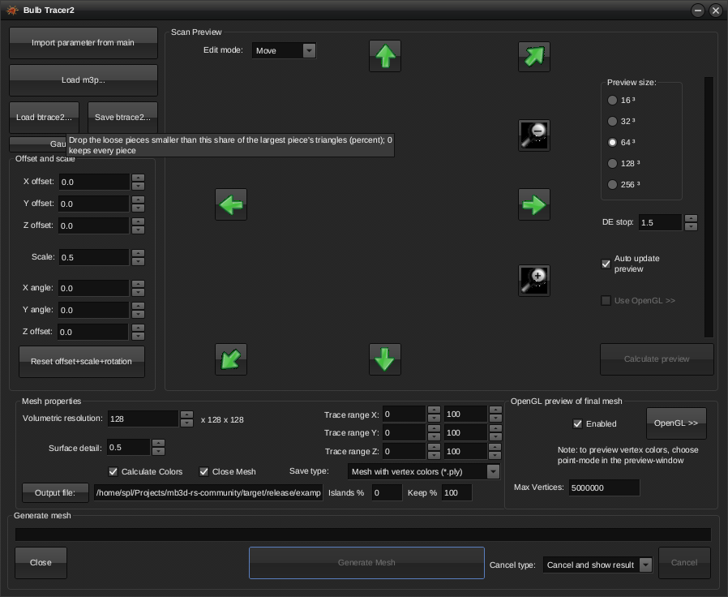</a>

* **Islands %** drops the loose pieces (connected parts of the mesh) whose triangle count is below this share of the largest piece's; 0 keeps every piece. The pieces are found by joining the vertices along the faces.
* **Keep %** reduces the mesh to this share of its vertices by vertex clustering: the vertices in each cell of a grid become their mean (the colours too), faces that collapse go, and the cell size is adjusted until the count comes out close. 100 keeps the mesh as traced.
* **tools/blender_import_mb3d.py** imports the .ply or .obj into Blender (3.0 or newer), recalculates the normals, shades smooth, and gives the mesh a material whose base colour is the vertex colour attribute, so a coloured export renders coloured at once. A splat .ply comes in as points. Run it from the Scripting workspace or with `blender --python tools/blender_import_mb3d.py -- file.ply`.

## 12. The benchmark

**What the group asks.** "Render this at 640 x 512 and post your Main Calc Time and your rig", and numbers that never compare because everyone's parameters and version differ.

**What the program does.** *Benchmark...* on the Internal tab (and `mb3d benchmark` on the command line) renders one fixed scene, the Integer Power preset at 640 x 512 with 60 iterations and the main pass alone, first on the processor, then on the graphics card (its first run compiles the shaders and does not count), and writes the result as text to copy and post: the program's version, the times, the processor's name and thread count, the card's name, the system.

<a href="img/community/benchmark_window.png">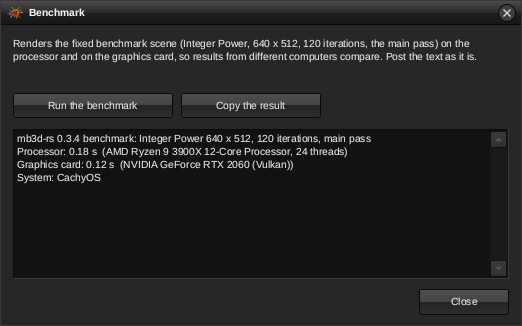</a>

## Two small fixes found on the way

* The light box behind a title-bar icon under the mouse used to be painted solid white, so the History and Log icons disappeared while the mouse was on them. The box is light again, and the icon shows through it.
* A hint wider than a narrow window, such as the Lighting or Formula window, was cut off. Such a hint now wraps at the window's width.
